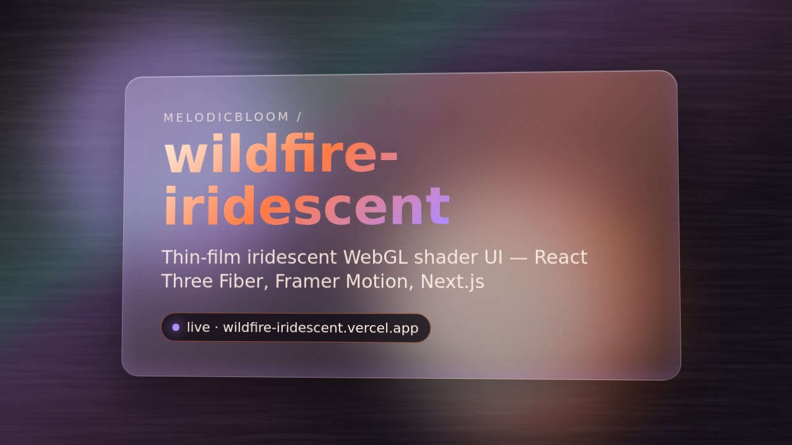

# wildfire-iridescent
High-fidelity WebGL shader UI system — iridescent thin-film effects, React Three Fiber, Framer Motion, Storybook, Next.js

## Visual proof

Poster links to an 8 s hero loop (`docs/visual-proof/hero.mp4`); social card at `docs/visual-proof/og.png`. Generated with [visual-proof-kit](https://github.com/MelodicBloom/visual-proof-kit).

Lighthouse: run locally — `npx lighthouse https://wildfire-iridescent.vercel.app --view`
